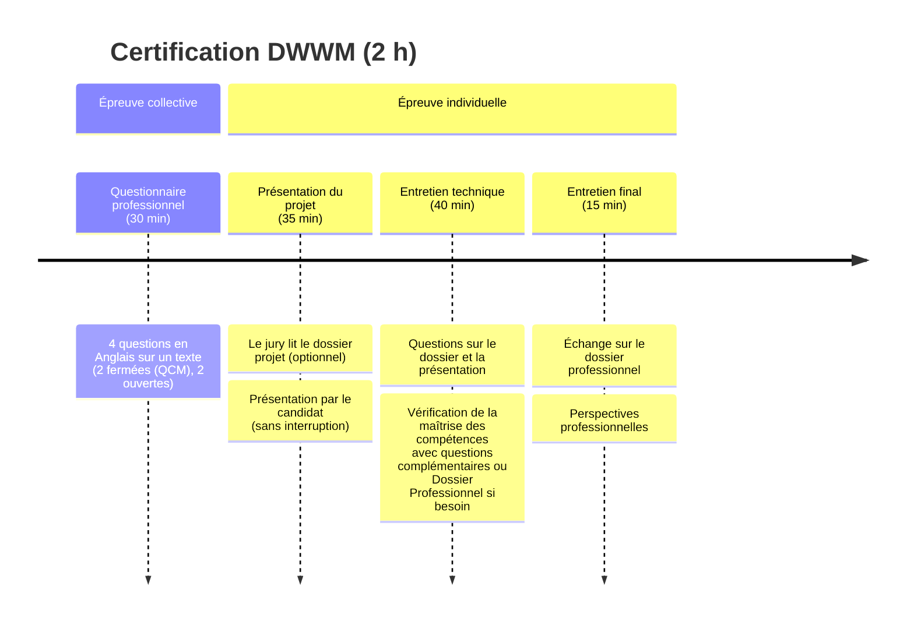

# Titre Professionnel Développeur Web et Web Mobile

Ce dépôt contient les 3 documents fournis au jury 
avant ma soutenance de la certification 
[Développeur Web et Web Mobile (RNCP37674 DWWM)](https://repertoirenationaldescertificationsprofessionnelles.fr/RNCP37674.html), 
un titre professionnel de niveau 5 (Bac+2).  

## Documents

1. **Diaporama** ([PDF](bouchut-eric-diaporama.pdf) | [en-ligne](https://www.ericbouchut.com/bouchut-eric-dossiers-pros-DWWM/)) :  
   donne la trame visuelle pour la **présentation** du projet au jury.
2. **[Dossier Projet](bouchut-eric-dossier-projet.pdf)** :  
   décrit le projet et servira de base pour l'échange lors de l'**entretien technique**.
   qui aura lieu ensuite.
3. **[Dossier Professionnel](bouchut-eric-dossier-pro.pdf)** :  
   décrit mes **réalisations** ainsi que les **compétences** que j'ai **acquises**
   au cours de la formation CDPI DWWM.

Si vous ne voulez que la substantifique moelle, alors lizez le **[résumé](bouchut-eric-resume.pdf)** du projet.

## Déroulement de la certification

## Projet

https://github.com/ebouchut/learn-dev

Les documents et la soutenance s'appuient sur mon projet de fin d'études: 
**[Learn-Dev](https://github.com/ebouchut/learn-dev)**.

Le [README](https://github.com/ebouchut/learn-dev?tab=readme-ov-file) vous expliquera comment l'installer, le configurer, et le lancer.

[CONTRIBUTING](https://github.com/ebouchut/learn-dev?tab=contributing-ov-file) explique comment contribuer au projet, quels sont les choix techniques et d'architecture.  
Il détaille les conventions de codage, de nommage des messages de commit, des tests, de le base de données, ainsi que le workflow des branches Git.  
Il contient les diagrammes avec le schéma de la base sous trois formes Merise (MCD, MLD, MPD) ainsi que ERD. 
Il aborde aussi comment lancer les tests et générer la documentation.

## Contact

- [Profil LinkedIn](https://linkedin.com/in/ebouchut)
- [Blog](https://www.ericbouchut.com/)
- [CV](bouchut-eric-cv.pdf)
