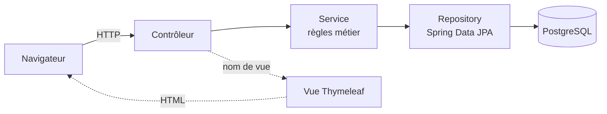
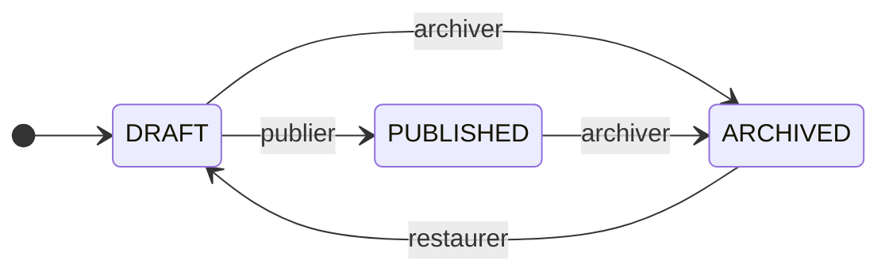
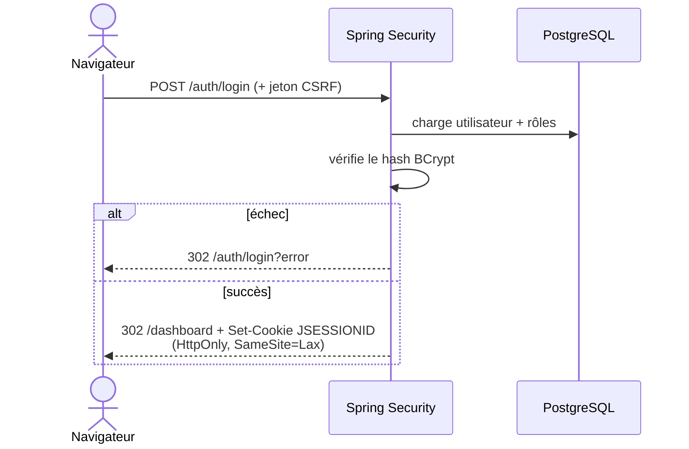

# learn-dev

## Plateforme Web d'apprentissage de la programmation

**Eric Bouchut** — Titre professionnel Développeur Web et Web Mobile (DWWM)

Soutenance — RNCP 37674 — session août 2026

<!--
(~0,5 min) 


- Saluer le jury.
- Se présenter brièvement.
-->

---
layout: section
---

# Introduction

---

# Le besoin

- **Contexte**: Apprendre à programmer suppose un **parcours structuré** : 
    - du contenu organisé, 
    - une progression lisible, 
    - un espace où un formateur publie et fait évoluer ses cours.
- **Problème** : offrir un environnement multi-rôles simple, **sûr** et **accessible**.
- **Solution** :

> *`learn-dev` est une plateforme Web où des formateurs publient des cours composés de leçons
> en Markdown, et où des étudiants s'inscrivent et les suivent.*

<!--
(~1 min) 

Me présenter. 

- Poser le besoin : structurer l'apprentissage du code. 
- Annoncer la solution en une phrase. 
- Enchaîner sur ce qu'est concrètement l'application.
-->

---

# Vue d'ensemble de learn-dev 

<div class="grid grid-cols-2 gap-6 items-center">

<div>

- **Trois rôles** : 
    - étudiant (`STUDENT`), 
    - formateur (`INSTRUCTOR`), 
    - administrateur (`ADMIN`).  

- **Étudiant** : catalogue, inscription à des cours, lecture des leçons.
- **Formateur** : création de cours/leçons, cycle de vie de publication, gestion des inscriptions.
- **Administrateur** : gestion des comptes, modération des contenus.

</div>


</div>

<!--
(~1 min)

- Décrire les 3 rôles et le parcours nominal. 
- Préciser : application Web rendue côté
serveur (Spring Boot + Thymeleaf), responsive et accessible.
-->

---
layout: section
---

# Conception

<!--
Cette section aborde:

- **l'organisation du travail** (aujourd'hui en solo, donc pas encore de SCRUM)
- le cahier des charges
- la modélisation des données et la base qui les stockent
- le maquettage et l'expérience utilisateur (UX)
- l'environnement de travail
-->

---

# Gestion de projet

- GitHub **Project**, 
- **Issues**,
- **ADR**s (*Architecture Decision Records*),
- **Plans** de développement,
- Développement **incrémental** : (authentification, domaine cours, création de contenu, administration),
- Git: **Branche par fonctionnalité**,
- **Conventional Commits**,
- **Pull-Requests**,
- **YAGNI**.

<!--
(~2 min)

Insister sur la démarche d'ingénierie :
- **[Project](https://github.com/users/ebouchut/projects/7/views/2)** pour **orchestrer** ce qui suit 
- **[Issues](https://github.com/ebouchut/learn-dev/issues)**: pour décrire les besoins fonctionnels et les bug
- **[ADR](https://github.com/ebouchut/learn-dev/blob/dev/docs/adr/README.md)** C'est l'**enregistrement des décisions d'architecture**s pour aider les nouveaux arrivants sur le projet (ou moi dans 6 mois :-).
  >  Chaque *ADR* répond à cette question: pourquoi a-t-on fait ce choix ?  
    - **Problème** à résoudre et les **contraintes**.
    - **Critères de décision**: ce qui a guidé le choix.
    - **Options** envisagées
    - **Option retenue**: pourquoi, bénéfices et compromis.
    - **Avantages/inconvénients** de chaque option.
- **[Plans](https://github.com/ebouchut/learn-dev/tree/dev/docs/plans)** de dev versionnés: Ils décrivent quoi faire et comment.
- [Branche Git par fonctionnalité](https://github.com/ebouchut/learn-dev/tree/dev?tab=contributing-ov-file#git-branching-strategy) pour que chaque développement n'impacte pas la branche commune (`dev`).
- [Pull-Requests](https://github.com/ebouchut/learn-dev/pulls?q=is:pr+is:closed)
- **`YAGNI`** : *You aren't gonna need it*  
  > Ne construire que ce qui est nécessaire pour la v1.

C'est de la communication écrite (compétence transversale).
-->

---

# Cahier des charges et personas

- **Objectifs** : s'inscrire et suivre des cours, publier/gérer des cours, administrer.
- **Personas** :
  - **Léa** (étudiante)
    - s'inscrit et suit des cours, sur mobile comme sur ordinateur.
  - **Marc** (formateur)
    - rédige les leçons de cours qu'il conçoit en Markdown, 
    - gère la publication de ses cours,
    - gère l'inscription des étudiants.
  - **Awa** (admin):
    - gère les comptes,
    - modère en toute sécurité.
- **Non fonctionnel** : sécurité, accessibilité RGAA, responsive, tests, CI.

<!--
(~2 min) 
Dérouler les besoins par persona. 
Relier aux besoins non fonctionnels.
-->

---
layout: section
---

# Base de données  <small>(CP5)</small>

---

# Base de données — MCD

Modèle Conceptuel de Données

<div class="grid grid-cols-2 gap-3 items-center">

<div>

- Entités
- Relations
- Cardinalités

</div>


</div>


<!--
(~1,5 min) 
Présenter la modélisation Merise (MCD). 
9 entités : utilisateurs, rôles, cours, leçons, inscriptions, jetons, audit. 
Montrer les associations et cardinalités.
-->

---

# Base de données — MLD <small>(CP5)</small>

Modèle Logique de Données (MLD)


<!--
(~1,5 min) 
Présenter la modélisation Merise (MLD ici). 
9 entités : utilisateurs, rôles, cours, leçons, inscriptions, jetons, audit. 
Montrer les tables, tables de jonctions et clés étrangères.
-->

---

# Base de données — MPD

Modèle Physique de Données

- **PostgreSQL 17**, **9 tables**, migrations **Liquibase** appliquées au démarrage.
- **Clé UUID** pour les utilisateurs (anti-IDOR) ; **BIGINT** ailleurs ; clés composites.
- **Contraintes** : `UNIQUE`, `CHECK`, `FK ON DELETE CASCADE` ; Hibernate en `validate`.


<!--
(~1,5 min) 
Justifier PostgreSQL (ADR-0007), 
Liquibase (ADR-0005), 
UUID (ADR-0003).
Souligner l'intégrité au plus près des données + contrôle anti-dérive de schéma en CI.
-->

---

# Maquettage et accessibilité <small>(CP2)</small>

<div class="grid grid-cols-[1fr_auto] gap-6 items-center">

<div>

- **Maquettes Figma** + prototypes HTML ; charte, deux thèmes (Catppuccin / Soft Paper).
- **Responsive** : versions Web (bureau) **et Web mobile** (points de rupture en `rem`).
- **Accessibilité RGAA / WCAG AA** : structure sémantique, *skip link*, contrastes
  calculés (min. 4,73:1), police **Atkinson Hyperlegible**.

</div>


</div>

<!--
(~2 min) Montrer la version mobile. Insister sur l'accessibilité « par construction » et les
contrastes mesurés. C'est CP2 (maquetter) : Web ET Web mobile.
-->

---

# Environnement technique <small>(CP1)</small>

- **Java 21** + **Spring Boot 3.5** (Web MVC, Security, Data JPA, Validation, Mail).
- **Thymeleaf** (vues), 
- **commonmark-java** 
- **jsoup**
- **PostgreSQL 17** + **Liquibase**.
- **Podman / Docker Compose** (Postgres, Mongo, Mailpit) ; **Maven** ; **Git** ; **CI GitHub Actions**.
- Architecture **en couches** :





<!--
(~2 min) 
Balayer la stack
justifier le rendu côté serveur (simplicité, sécurité, SEO).
Montrer l'outillage (conteneurs, CI). 
C'est CP1.
-->

---
layout: section
---

# Développement

---

# Deux fonctionnalités CRUD

- **Feature 1 — Inscription d'un utilisateur** (validation, sécurité, jeu d'essai).
- **Feature 2 — Gestion des cours et leçons** (cycle de vie, autorisations).
- Motif commun : **Contrôleur → Service (règles métier) → Repository**, erreurs HTTP
  explicites (**403 / 404 / 409**).

<!--
(~1 min) Annoncer les 2 features CRUD qui vont être démontrées et l'architecture commune.
-->

---

# Feature 1 — Inscription <small>(CP4, CP7)</small>

<div class="grid grid-cols-2 gap-4 items-center">

<div>

- Formulaire **validé** (Bean Validation), **erreurs accessibles**.
- **Unicité** username/e-mail ; motif **Post-Redirect-Get**.

```java
public User register(RegisterForm form) {
    if (users.existsByUsername(form.username())) {
        throw new DuplicateUsernameException();
    }
    if (users.existsByEmail(form.email())) {
        throw new DuplicateEmailException();
    }
    // hachage BCrypt, jamais de mot de passe en clair
    user.setPassword(encoder.encode(form.password()));
    return users.saveAndFlush(user);
}
```

</div>


</div>

<!--
(~2 min) Démo/écran de l'inscription. Montrer la validation et les messages d'erreur reliés
au champ (aria). Le code : unicité + hachage BCrypt, jamais de mot de passe en clair.
CP4 (dynamique) + CP7 (composant métier).
-->

---

# Jeu d'essai — Inscription

| Scénario | Attendu | Obtenu |
|---|---|---|
| Cas nominal | Compte créé, mot de passe **haché**, rôle `STUDENT` | Conforme |
| E-mail déjà utilisé | Erreur de champ, **aucune** création | Conforme |
| Mot de passe trop court (< 8) | Rejet par la validation | Conforme |
| E-mail invalide | Rejet par la validation | Conforme |

<!--
(~1,5 min) Dérouler le jeu d'essai : entrées, attendu, obtenu, écarts (aucun). Couvert par
des tests automatisés.
-->

---

# Feature 2 — Cours et leçons <small>(CP7)</small>

- **Autorisations** : le cours d'un autre formateur → **403** ; contenu invisible → **404** ;
  transition invalide → **409**.
- Réordonnancement des leçons, gestion des inscrits, **journal d'audit**.



<!--
(~2,5 min) Montrer l'espace formateur : création, publication, réordonnancement. Insister
sur les règles métier (cycle de vie ci-dessus, appliqué aux cours ET aux leçons) et la
gestion fine des erreurs HTTP. CP7.
-->

---

# Front-end : interfaces et responsive <small>(CP3, CP4)</small>

<div class="grid grid-cols-2 gap-6 items-center">

<div>

- **21 gabarits Thymeleaf**, HTML5 sémantique, CSS responsive, fragment de mise en page
  partagé.
- Rendu **dynamique** du Markdown des leçons (converti puis **assaini** contre les XSS).
- Navigation précédent/suivant, affichage conditionnel selon le rôle.

</div>


</div>

<!--
(~2 min) Montrer le catalogue. Rappeler responsive + RGAA (CP3) et la partie dynamique
serveur (CP4).
-->

---

# Accès aux données <small>(CP6)</small>

- **Spring Data JPA** : *repositories* = interfaces, requêtes **dérivées** et
  **paramétrées** (anti-injection SQL) ; `@Transactional`.
- **NoSQL** : MongoDB **provisionné** en vue d'un stockage de contenu (non encore branché).

```java
public interface UserRepository extends JpaRepository<User, UUID> {

    @EntityGraph(attributePaths = "roles")   // l'utilisateur ET ses rôles en 1 requête
    Optional<User> findByUsername(String username);

    boolean existsByUsername(String username);
    boolean existsByEmail(String email);
}
```

<!--
(~1,5 min) Montrer le repository : une interface, Spring génère l'implémentation ; requêtes
paramétrées donc pas d'injection SQL. Assumer honnêtement l'écart NoSQL : SQL au cœur,
MongoDB prêt mais pas branché. CP6.
-->

---

# Sécurité

<div class="grid grid-cols-2 gap-4 items-start">

<div>

- **BCrypt**, **CSRF** activé, **anti-XSS** (jsoup).
- **Anti-IDOR** (UUID), **anti-énumération**, **verrouillage de compte**, **rate-limiting**.
- Jetons **hachés SHA-256**, **journal d'audit**, matrice d'autorisations **testée**.
- Référence **OWASP Top 10** ; veille **Semgrep**.

</div>



</div>

<!--
(~2 min) Balayer les défenses, 
dérouler la séquence de connexion : 
- CSRF, 
- BCrypt,
- session HttpOnly. 

Relier à OWASP. C'est un point fort : sécurité dès la conception.
-->

---

# Tests

- **64 tests** (pyramide) : unitaires (Mockito), tranche JPA, intégration (MockMvc).
- **PostgreSQL réel** en test via **Testcontainers** (schéma fidèle : UUID, contraintes).
- **Couverture** du code par les tests :
    -  mesurée par **JaCoCo**, 
    - publiée sur **[Codecov](https://app.codecov.io/gh/ebouchut/learn-dev)**.


<!--
(~1,5 min) 
Montrer:
- la stratégie de tests 
- la matrice de sécurité. 
La CI verrouille la qualité à chaque push.
-->

---
layout: section
---

# Déploiement

---

# Conteneurisation et CI <small>(CP8)</small>

- **Image Docker multi-étapes** : build Maven puis exécution **non-root**.
- **Docker Compose** (Postgres / Mongo / Mailpit)
- **Profils** `dev`/ `prod`
- **Secrets** via `.env`.
- **Procédure documentée**
  ```bash
  docker compose up -d        # 1. services (base de données, SMTP local)
  ./mvnw spring-boot:run      # 2. application => http://localhost:8080
  ```
- **CI GitHub Actions** (4 workflows): 
    - build, 
    - tests, 
    - lint, 
    - contrôle anti-dérive du schéma.


<!--
(~4 min) 
Rappeler : le déploiement en prod n'est pas exigé, 
c'est la QUALITÉ de la procédure documentée qui compte. 

Montrer : 
- le Dockerfile
- un workflow CI. 

CP8.
-->

---
layout: section
---

# Conclusion

---

# Bilan des compétences

| CP | Compétence | Où |
|---|---|---|
| CP1 | Environnement de travail | Stack, Docker, CI |
| CP2 | Maquetter | Figma, RGAA, responsive |
| CP3 | Interfaces statiques | Thymeleaf, CSS, thèmes |
| CP4 | Interfaces dynamiques | Formulaires, PRG, Markdown |
| CP5 | Base de données | Merise, PostgreSQL, Liquibase |
| CP6 | Accès aux données | Spring Data JPA (+ Mongo) |
| CP7 | Composants métier | Services, règles, erreurs HTTP |
| CP8 | Déploiement | Docker, Compose, CI/CD |

<!--
(~1,5 min) 
Récapituler : les 8 compétences sont couvertes.
Rappeler que le jury évalue des compétences, pas des fonctionnalités.
-->

---

# Difficultés et évolutions

- **Difficultés** : 
    - concurrence à l'inscription (contrainte d'unicité captée),
    - sécurité du rendu Markdown (assinissement des entrées pour éviter XSS),
    - un seul `h1` par page (accessibilité).
- **Évolutions** : 
    - brancher **MongoDB** (NoSQL),
    - suivre la progression leçon par leçon,
    - API REST pour utiliser de React.

<!--
(~1 min)

Ouvrir sur les évolutions,
notamment le volet NoSQL.
-->

---
layout: center
class: text-center
---

# Merci

**Merci de votre attention.**

Projet : **[github.com/ebouchut/learn-dev](https://github.com/ebouchut/learn-dev)**

Des questions ?

<!--
(~0,5 min)

Remercier le jury et l'équipe pédagogique. 
Inviter aux questions.
-->
